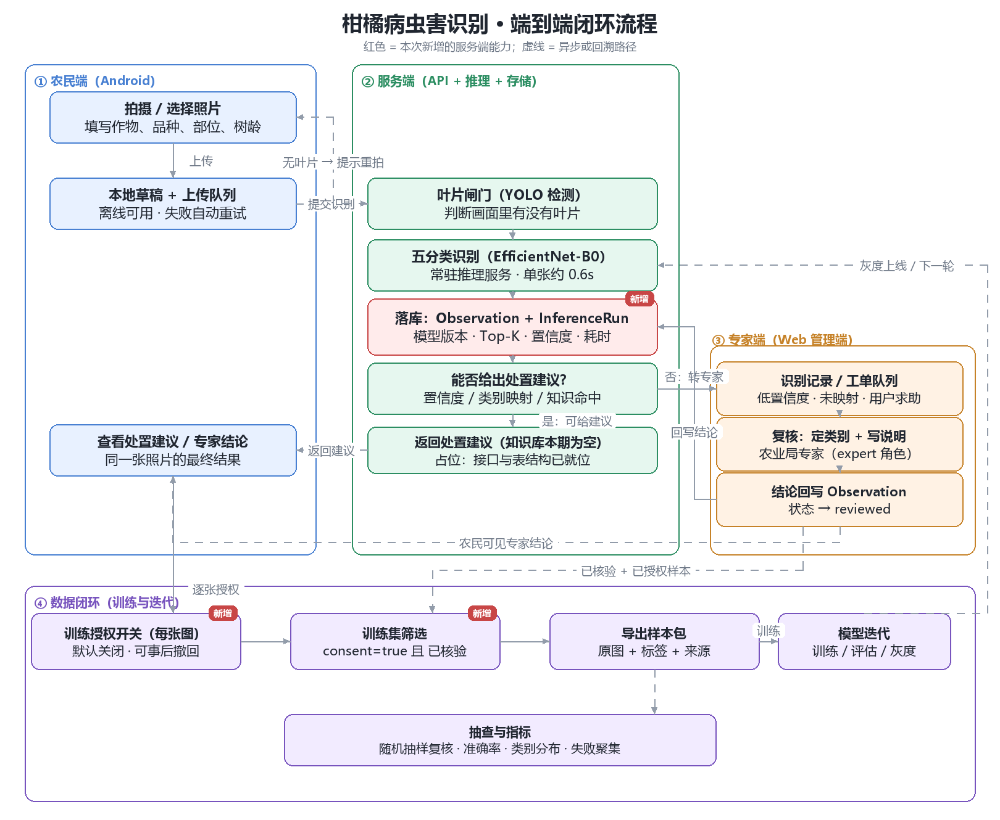
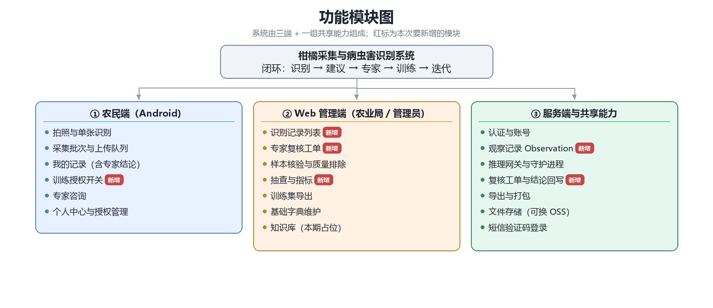
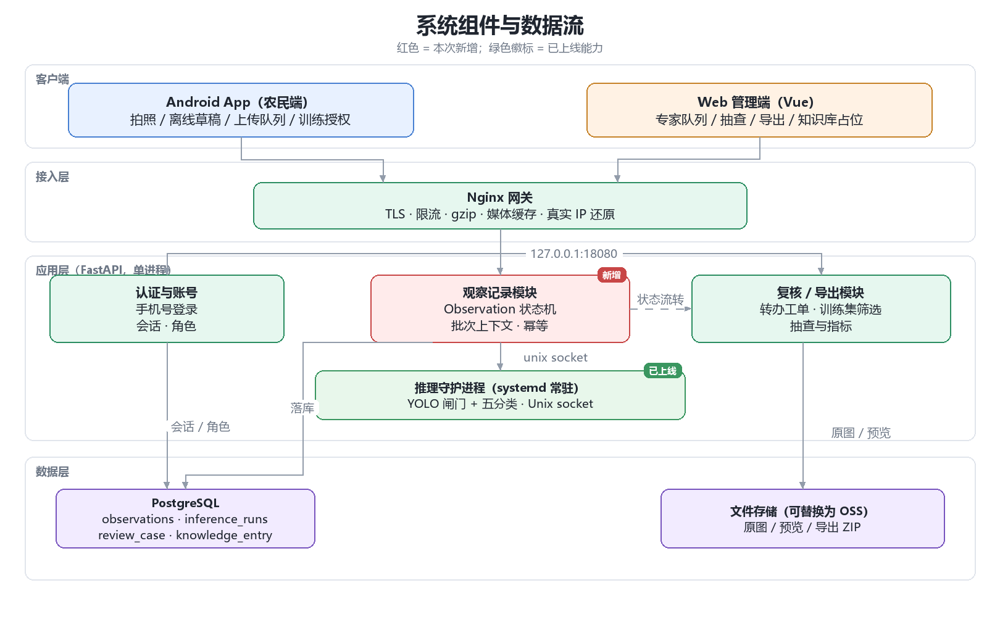
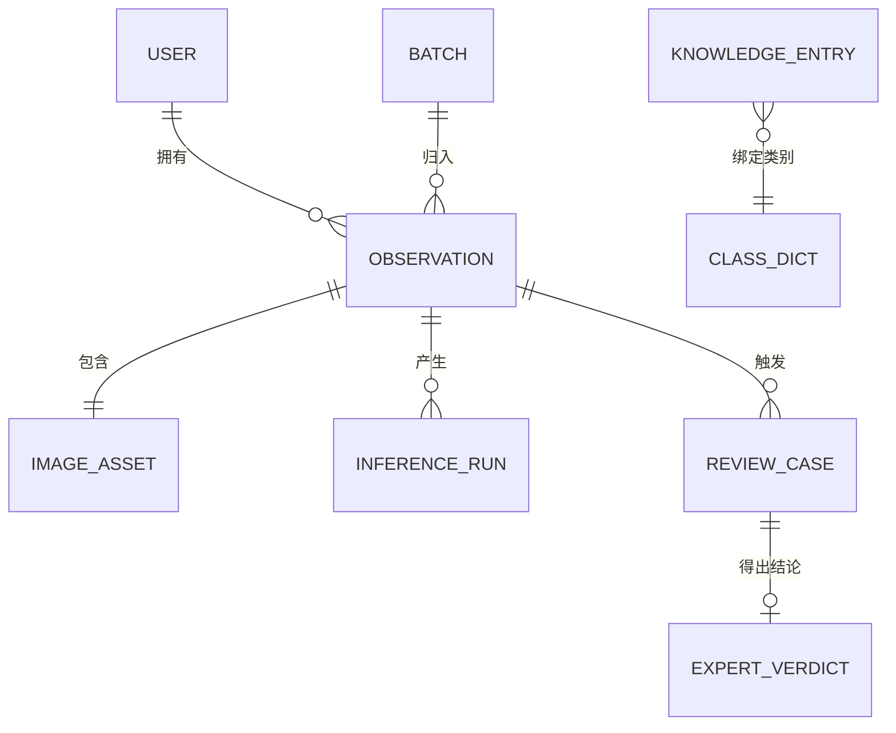
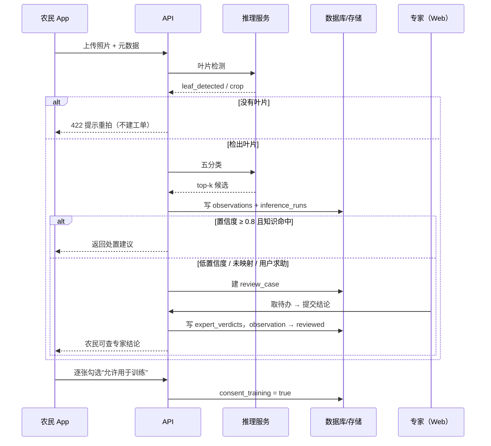
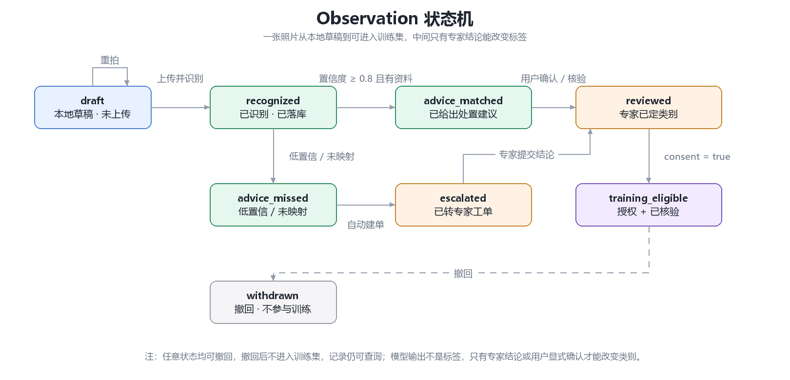
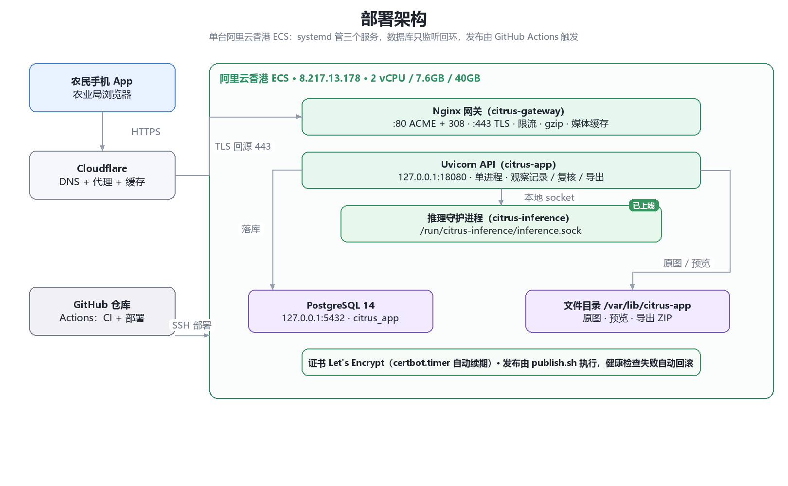

# 柑橘病虫害识别系统：闭环架构设计

日期：2026-11-02　版本：v1（待评审）　状态：评审通过后进入实施

## 0. 图表索引

| 图 | 文件 | 回答什么问题 |
| --- | --- | --- |
| 业务流程图（闭环） | `diagrams/closed-loop-flow.png` | 数据怎么从头走到尾，谁在什么时候介入 |
| 功能模块图 | `diagrams/modules.png` | 系统有哪些功能，哪些端负责，哪些是新增 |
| 系统架构图 | `diagrams/architecture.png` | 组件怎么分层，谁调谁 |
| ER 图 | 本文第 6 节（mermaid） | 有哪些表，表之间什么关系 |
| 时序图 | 本文第 7 节（mermaid） | 一次识别在前后端之间怎么交互 |
| 状态机图 | `diagrams/state-machine.png` | 一条记录如何流转到可训练 |
| 部署架构图 | `diagrams/deployment.png` | 服务跑在哪，怎么发布，怎么回滚 |

图由 `diagrams/make_diagrams.py` 生成，改文案或布局后重跑即可，不需要手工重画。

## 1. 目标

让这条链路真正闭环，而不是"功能都有但数据不落地"：

> 农民拍照 → 模型识别 → 知识库给出处置建议 → 识别不出则转专家 → 专家结论回写 → 照片按授权可用于训练 → 模型迭代

判断标准只有一条：**每一次识别都留下可追溯的记录**——谁、何时、拍的什么、当时模型怎么判断、专家怎么看、最后有没有进入训练。

## 2. 现状诊断

| # | 症状 | 证据 | 影响 |
| --- | --- | --- | --- |
| 1 | 同一张照片两条互不相通的路 | 采集有 `samples/uploads/images` 表；识别 `POST /recognitions` 只返回候选、不落库 | 识别数据进不了训练，专家看不到 |
| 2 | 服务端不是真相源 | 识别结果与 `advice` 只在手机本地 Room；`receipt` 由客户端持有 | 换机即丢、Web 不可见、无法统计 |
| 3 | 模型输出没沉淀 | 无 `inference_runs` 表 | 不知道真实场景准确率、类别分布、版本差异 |
| 4 | 两套字段建模 | 采集：品种/部位/类别/症状；识别：作物/部位/树龄/现场现象 | 词表不统一，统计口径分裂 |
| 5 | 三条孤立通道 | 采集复核、专家咨询、识别建议互不相干 | 专家要在三个页面之间切换 |

## 3. 已确认的决策

| 决策 | 内容 | 落地方式 |
| --- | --- | --- |
| 训练授权 | **每张照片单独授权**，默认关闭，可事后撤回 | `observation.consent_training` + `consent_at` + `policy_version` |
| 原图保留 | 暂时**全部保留** | 保持 `FileStorage` 抽象；磁盘水位告警；预留 OSS 适配 |
| 专家 | **农业局人员**，登录现有管理端，不做通知与结算 | 复用 `expert` 角色与 Web 管理端 |
| 知识库 | **本期只占位**，不实现内容 | 建表 + 建接口 + 管理端只读入口，数据为空 |

容量提醒（按 200 人 × 5 张/天估算）：原图 3.14MB/张 → 约 **3.1GB/天**，40GB 系统盘约 **10 天写满**。本期不限制，但必须同时具备：磁盘 70% 告警、存储后端可替换、原图只增不改。

## 4. 功能模块

| 端 | 模块 | 状态 |
| --- | --- | --- |
| 农民端 App | 拍照与单张识别、采集批次与上传队列、我的记录、专家咨询、个人中心 | 已有 |
| 农民端 App | **训练授权开关**（逐张） | 新增 |
| Web 管理端 | 样本核验与质量排除、训练集导出、基础字典、知识库（占位） | 已有/占位 |
| Web 管理端 | **识别记录列表、专家复核工单、抽查与指标** | 新增 |
| 服务端 | 认证与账号、推理网关、导出与打包、文件存储、短信登录 | 已有 |
| 服务端 | **观察记录 Observation、复核工单与结论回写** | 新增 |

## 5. 系统架构

四层职责：

- **客户端**：Android 负责任离线采集与待上传队列；Vue 管理端负责专家复核、抽查与导出；
- **接入层**：Nginx 网关统一处理 TLS、限流、gzip、媒体缓存与真实 IP 还原；
- **应用层**：FastAPI 单进程，按模块拆分（认证 / 观察记录 / 复核导出）；推理是独立进程，通过 Unix socket 调用；
- **数据层**：PostgreSQL 存元数据，文件存储存字节（保持可替换为 OSS）。

## 6. 数据模型（ER）

核心是把"采集"和"识别"合并成同一个实体 **Observation**——一张照片的一次判断。

| 实体 | 关键字段 | 说明 |
| --- | --- | --- |
| `observations` | id, user_id, batch_id, image_id, cultivar, part, tree_age, symptom, state, consent_training, consent_at, policy_version | 状态见第 8 节 |
| `inference_runs` | id, observation_id, model_name, model_version, top_labels(json), score, leaf_detected, latency_ms, error | 每次推理一条，**模型效果的唯一事实来源** |
| `review_cases` | id, observation_id, reason, status, assignee, opened_at, closed_at | 转专家工单 |
| `expert_verdicts` | id, case_id, class_id, note, quality_flags, expert_id | 专家结论，**标签的唯一来源** |
| `knowledge_entries` | id, class_id, cultivar, part, tree_age_range, title, actions, precautions, sources, status, version | 本期建表不填数据 |
| `classes` / `cultivars` / `part` | 复用现有字典 | 词表统一的关键 |

三条硬规则：

1. **模型输出永远不是标签**——只进 `inference_runs`；
2. **建议必须可追溯**——记录命中哪条知识、哪一版；
3. **授权与核验同时满足才能进训练集**。

## 7. 时序（一次识别）

## 8. 状态机

| 状态 | 含义 | 谁能进入下一步 |
| --- | --- | --- |
| `draft` | 本地草稿，未上传 | 用户上传 |
| `recognized` | 已识别并落库 | 系统 |
| `advice_matched` | 已给出处置建议 | 系统（置信度高且有资料） |
| `advice_missed` | 低置信 / 未映射，无建议 | 系统 |
| `escalated` | 已转专家工单 | 系统自动或用户主动 |
| `reviewed` | 专家已定类别 | 专家 |
| `training_eligible` | 授权 + 已核验，可进训练集 | 条件满足自动 |
| `withdrawn` | 撤回，不参与训练，记录仍可查 | 用户 |

## 9. 转专家触发规则

| 情况 | 是否转专家 | 理由 |
| --- | --- | --- |
| 置信度 < 0.80 | ✅ | 模型自己不确定 |
| Top1 与 Top2 差值 < 0.20 | ✅ | 类别边界模糊 |
| 类别未映射到字典（unmapped） | ✅ | 系统没有对应类别 |
| 用户主动点"请专家看" | ✅ | 农民的主观判断很重要 |
| **叶片闸门失败（NO_LEAF）** | ❌ | 拍的是窗帘/地面，提示重拍 |
| 网络超时、服务错误 | ❌ | 系统问题，提示重试 |

## 10. 知识库占位形态

本期不填内容，但结构必须就位，避免将来改契约：

- 表 `knowledge_entries` 建好（字段见第 6 节）；
- `advise` 逻辑不变：无资料 → `status = unavailable`；
- 文案调整为"处置建议正在整理，已转交专家"；
- 管理端提供**只读**的"知识库（待补充）"入口。

## 11. 部署架构

| 组件 | 形态 | 端口 / 路径 |
| --- | --- | --- |
| Nginx 网关 | systemd `citrus-gateway` | 80（ACME + 308）、443 |
| API | systemd `citrus-app`（uvicorn 单进程） | 127.0.0.1:18080 |
| 推理守护 | systemd `citrus-inference` | `/run/citrus-inference/inference.sock` |
| 数据库 | PostgreSQL 14 | 127.0.0.1:5432 |
| 文件 | `/var/lib/citrus-app`（可换 OSS） | 原图 / 预览 / ZIP |
| 发布 | GitHub Actions → `publish.sh` | releases/<sha> + 软链，失败自动回滚 |

## 12. 存储与合规

| 数据 | 位置 | 策略 |
| --- | --- | --- |
| 320 缩略图 | 本地盘 | 全量长期（约 13KB/张） |
| 1024 预览 | 本地盘 | 全量（约 130KB/张，已剥离 EXIF/GPS） |
| 原图 | 本地盘（本期）→ 可切 OSS | 全量保留；磁盘 70% 告警 |
| 导出 ZIP | 本地盘 | 按需生成，定期清理 |

原图可能含 GPS 与人脸，属个人信息/敏感个人信息。预览已剥离元数据；隐私说明需写明用途与保留期限，并提供删除入口。

## 13. 分阶段实施

| 阶段 | 内容 | 验收 | 回滚 |
| --- | --- | --- | --- |
| **A** | `observations` + `inference_runs`，识别接口**双写**；管理端只读列表 | 手机识别一次，管理端能看到记录 + 模型版本 + 置信度 | 关闭双写开关，App 无感 |
| **B** | 转专家：触发规则 + `review_case` + 专家待办 + 结论回写 | 低置信度图自动进队列；专家填完，App 刷新可见 | 关闭转办开关 |
| **C** | App：逐张训练授权 + 专家结论展示 | 未授权的图不出现在导出包 | 授权字段可空，默认关闭 |
| **D** | 抽查与导出：随机抽样、低置信度筛选、导出按授权过滤 | 导出 ZIP 只含已授权且已核验样本 | 导出保留旧路径 |

**A 最急**：不改任何客户端行为，却能把每天流走的数据接住。

## 14. 本期不做

- 知识库内容与图谱推理（只占位）；
- 通知渠道（短信/微信）与专家 SLA；
- 异步识别队列（202 + 轮询）；
- 多机构 / 多租户；
- 对象存储迁移（只预留）。

## 15. 风险与开放问题

1. **存储**：全量原图在 1000 张/天时约 10 天写满系统盘，需在 A 阶段同步加告警；
2. **标注噪声**：用户"采用结果"不等于正确，训练集只认专家结论或显式确认；
3. **专家负载**：转办规则上线后需观察工单量，必要时加每日上限或抽样送审；
4. **模型版本追溯**：`inference_runs` 必须记录权重指纹，否则历史记录无法解释。
